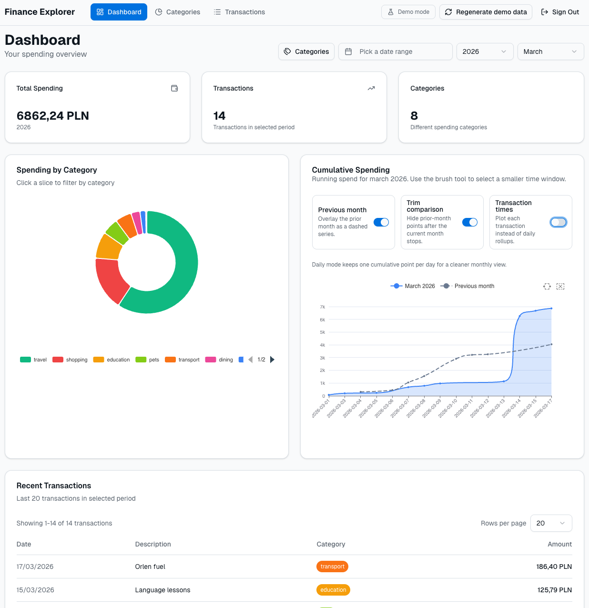
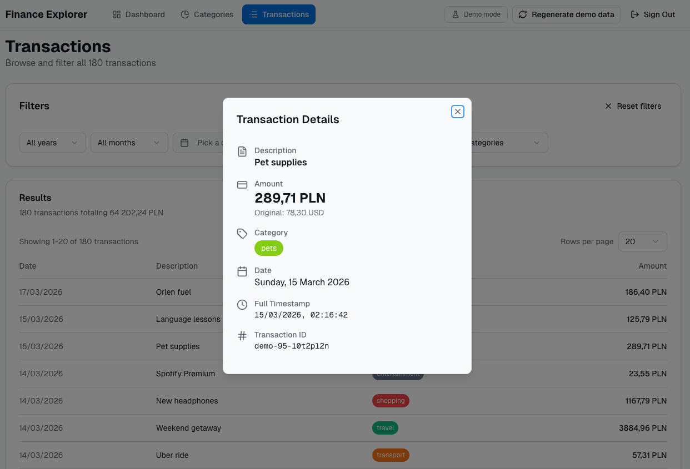
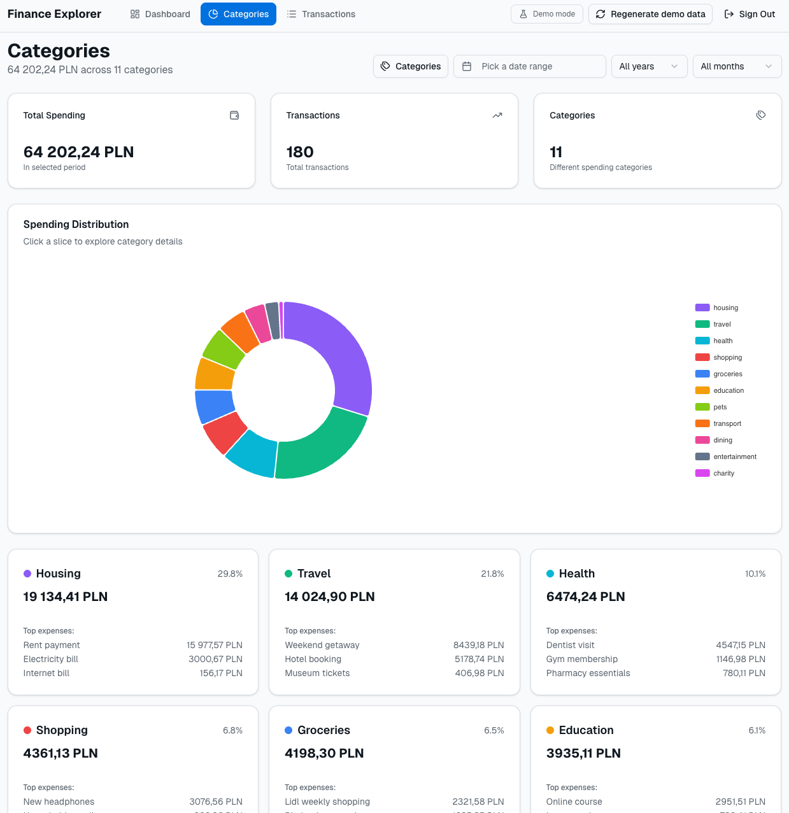
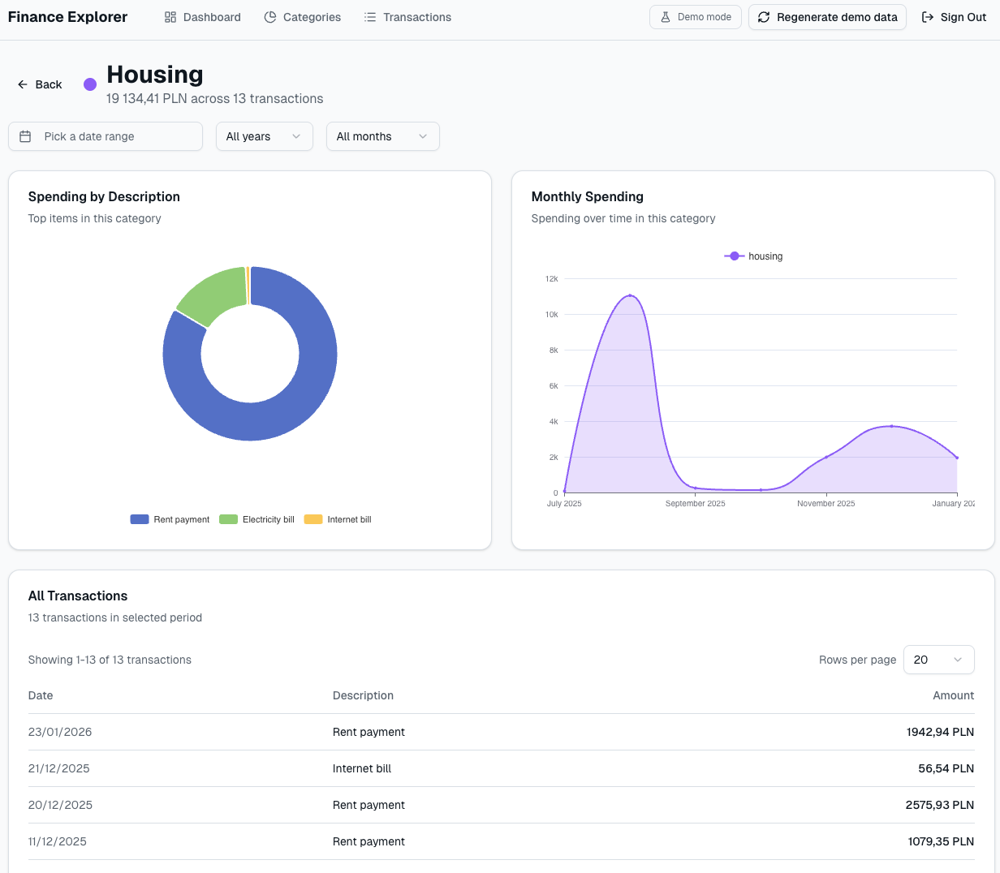

# Personal Finance Explorer

<p align="center">
  
</p>

[](https://vercel.com/new/clone?repository-url=https%3A%2F%2Fgithub.com%2Fmaxiwoj%2Fpersonal-finance-explorer-rs&env=NEXT_PUBLIC_GOOGLE_CLIENT_ID,GOOGLE_CLIENT_SECRET,NEXT_PUBLIC_GOOGLE_API_KEY,NEXT_PUBLIC_GOOGLE_APP_ID&envDescription=Required%20Google%20OAuth%20client%20ID%20and%20secret%2C%20Picker%20API%20key%2C%20and%20Cloud%20project%20number.%20See%20the%20Deployment%20Guide%20for%20setup%20instructions.&envLink=https%3A%2F%2Fgithub.com%2Fmaxiwoj%2Fpersonal-finance-explorer-rs%2Fblob%2Fmain%2Fdocs%2Fdeployment.md%233-environment-variables)

A powerful, privacy-focused personal finance dashboard that turns your Google Sheets into a rich, interactive explorer. Built with Next.js, Google OAuth 2.0, and high-performance charting.

[](https://v0-personal-finance-dashboard-eta-seven.vercel.app/)



## Why Personal Finance Explorer?

- **Your data stays in your Google Sheet**: There is no database. Transactions are read straight from the Google Sheets API into your browser; the app's server never receives them.
- **Minimal Google access**: Only the `drive.file` scope (plus your email for sign-in), so the app can open just the spreadsheet you pick, not the rest of your Drive. It writes only when you add or edit a transaction, and only the input columns (Timestamp to Currency) of the `expenses` tab.
- **Local cache only**: Transactions are cached in your browser (IndexedDB) for fast loads and cleared on sign-out.
- **No vendor lock-in**: Keep using Sheets however you like; the app is just a view on top. Self-host your own instance in one click.
- **Server is auth-only**: The backend just exchanges and refreshes Google OAuth tokens (refresh token kept in an HTTP-only cookie).

> Note: the app includes [Vercel Web Analytics](https://vercel.com/docs/analytics) for page-view stats. It does not receive your spreadsheet data.

## Try the Live Demo

Want to see the app in action? Visit the [live demo](https://v0-personal-finance-dashboard-eta-seven.vercel.app/) to experience the full functionality with sample data.

**Note**: The demo is deployed with sample data for demonstration purposes. To use your own data, sign in with Google, make a copy of the [template spreadsheet](https://docs.google.com/spreadsheets/d/1KTNJ1fwJbM3uFzJzz3Duc2MP88Ybx2OiXrYa51cooKo/copy), and select it with the built-in Google Drive picker. The app can only access the file you select.

## Features

- **Google Sheets Integration**: Directly syncs with your Google Spreadsheet, selected from your Drive after sign-in. The app can only access the file you select and does not store any of your data on its servers.
- **Interactive Dashboard**: Get a high-level overview of your spending, income, and net flow with dynamic charts.
- **Detailed Transaction Explorer**: Search, filter, and drill down into every transaction.
- **Add and Edit Transactions**: Add a transaction from the app and edit existing ones from the transaction details. Category order and colors can be fixed with an optional `categories` tab.
- **Quick Add on iPhone**: Open `/add` in Safari, tap **Share → Add to Home Screen**, and turn off **Open as Web App** if shown, so the shortcut shares Safari's sign-in.
- **Multi-dimensional Filtering**: Filter by date range, month/year, and categories.
- **Privacy First**: Authenticate with Google OAuth and keep your data in your own spreadsheet.

## Screenshots

### Transactions Explorer


### Finance Analysis
#### Categories


#### Category Deep Dive


## Development getting started

### Prerequisites

- Node.js 18.x or later
- A Google Cloud Project with the Google Sheets API and Google Picker API enabled
- A Google Spreadsheet with your financial data in the [template](https://docs.google.com/spreadsheets/d/1KTNJ1fwJbM3uFzJzz3Duc2MP88Ybx2OiXrYa51cooKo/copy) format

### Development

1. **Clone the repository:**
   ```bash
   git clone https://github.com/your-username/personal-finance-explorer-rs.git
   cd personal-finance-explorer-rs
   ```

2. **Install dependencies:**
   ```bash
   pnpm install
   ```

3. **Configure Environment Variables:**
   Create a `.env.local` file in the root directory and add the following:
   ```env
   NEXT_PUBLIC_GOOGLE_CLIENT_ID=your_client_id
   NEXT_PUBLIC_GOOGLE_API_KEY=your_picker_api_key
   NEXT_PUBLIC_GOOGLE_APP_ID=your_cloud_project_number
   # Optional: spreadsheet tried before asking the user to pick one
   NEXT_PUBLIC_SPREADSHEET_ID=your_spreadsheet_id
   GOOGLE_CLIENT_SECRET=your_client_secret
   ```
   *For detailed setup instructions, see the [Deployment Guide](./docs/deployment.md).*

4. **Run the development server:**
   ```bash
   set -a; source .env.local; set +a
   pnpm dev
   ```
   Open [http://localhost:3000](http://localhost:3000) to see the application.

## 📖 Documentation

- [Architecture Overview](./docs/architecture.md) - Deep dive into how the app works.
- [Setup & Deployment](./docs/deployment.md) - Comprehensive guide from Google OAuth to Vercel.

## 🚀 Quick Deployment

### One-Click Vercel Deployment
[](https://vercel.com/new/clone?repository-url=https%3A%2F%2Fgithub.com%2Fmaxiwoj%2Fpersonal-finance-explorer-rs&env=NEXT_PUBLIC_GOOGLE_CLIENT_ID,GOOGLE_CLIENT_SECRET,NEXT_PUBLIC_GOOGLE_API_KEY,NEXT_PUBLIC_GOOGLE_APP_ID&envDescription=Required%20Google%20OAuth%20client%20ID%20and%20secret%2C%20Picker%20API%20key%2C%20and%20Cloud%20project%20number.%20See%20the%20Deployment%20Guide%20for%20setup%20instructions.&envLink=https%3A%2F%2Fgithub.com%2Fmaxiwoj%2Fpersonal-finance-explorer-rs%2Fblob%2Fmain%2Fdocs%2Fdeployment.md%233-environment-variables)

Deploy your own instance of this app with just one click! Simply click the "Deploy with Vercel" button above, and follow these steps:

1. Sign in to your Vercel account (or create one if you don't have it)
2. Connect your GitHub account when prompted
3. Fill in the required environment variables (see [Environment Variables](./docs/deployment.md#3-environment-variables) for where each comes from):
   - `NEXT_PUBLIC_GOOGLE_CLIENT_ID`: Your Google OAuth Client ID
   - `GOOGLE_CLIENT_SECRET`: Your Google OAuth Client Secret
   - `NEXT_PUBLIC_GOOGLE_API_KEY`: API key for the Google Picker
   - `NEXT_PUBLIC_GOOGLE_APP_ID`: Your Google Cloud project number
   - `NEXT_PUBLIC_SPREADSHEET_ID` (optional, add later in project settings): Default spreadsheet ID
4. Click "Deploy" and your app will be live in minutes!

For detailed setup instructions, see the [Setup & Deployment Guide](./docs/deployment.md).

## Contributing

Contributions are welcome! Please feel free to submit a Pull Request.
