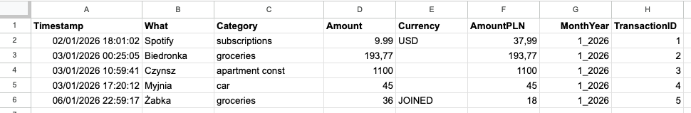

# Setup & Deployment Guide

This guide covers everything from configuring Google Cloud to deploying your own instance of the Personal Finance Explorer on Vercel.

---

## 1. Google Cloud Configuration

### Create Google Cloud Project
1. Go to [Google Cloud Console](https://console.cloud.google.com/).
2. Create a new project (e.g., `finance-explorer`).

### Enable APIs
1. Go to **APIs & Services > Library**.
2. Search for **Google Sheets API** and click **Enable**.
3. Search for **Google Picker API** and click **Enable**.

### Configure OAuth Consent Screen
1. Go to **APIs & Services > OAuth consent screen**.
2. Choose **External** and fill in required fields (app name, email).
3. Add scope: `https://www.googleapis.com/auth/drive.file`. It is non-sensitive and grants access only to files the user selects in the picker, so the app does not need restricted-scope verification.

### Create OAuth Client Credentials
1. Go to **APIs & Services > Credentials**.
2. Click **Create Credentials > OAuth client ID**.
3. Choose **Web application**.
4. **Authorized JavaScript origins**: add every origin the app runs on (see [Authorized origins](#authorized-origins)):
    - `http://localhost:3000`
    - `https://your-app.vercel.app`
    - `https://your-custom-domain.com` (only if you use one)
5. **Authorized redirect URIs**: leave empty. Sign-in uses the Google popup code flow (`redirect_uri: 'postmessage'`), which only checks the JavaScript origin.
6. Copy the **Client ID** (`NEXT_PUBLIC_GOOGLE_CLIENT_ID`) and **Client Secret** (`GOOGLE_CLIENT_SECRET`).

### Create a Picker API Key
1. Go to **APIs & Services > Credentials** and click **Create Credentials > API key**.
2. Click the key and restrict it:
    - **Application restrictions** → **Websites**, add the same origins as the OAuth client, each with a `/*` suffix (see [Authorized origins](#authorized-origins)):
        - `http://localhost:3000/*`
        - `https://your-app.vercel.app/*`
        - `https://your-custom-domain.com/*` (only if you use one)
        - optionally `https://*-your-team.vercel.app/*` for Vercel preview deployments
    - **API restrictions** → **Restrict key** → **Google Picker API**.
3. Save (changes can take a few minutes to apply) and copy the key (`NEXT_PUBLIC_GOOGLE_API_KEY`).

The key is visible in the browser, which is expected for the Picker; the restrictions are what protect it.

### Authorized origins

The OAuth client and the Picker API key must allow the same set of origins. A missing origin breaks sign-in (OAuth client) or the picker (API key) on that URL.

| Origin | OAuth client: Authorized JavaScript origins | Picker API key: Website restrictions |
|---|---|---|
| Local dev | `http://localhost:3000` | `http://localhost:3000/*` |
| Vercel production | `https://your-app.vercel.app` | `https://your-app.vercel.app/*` |
| Custom domain (optional) | `https://your-custom-domain.com` | `https://your-custom-domain.com/*` |
| Vercel previews (optional) | each preview URL, added explicitly (no wildcards) | `https://*-your-team.vercel.app/*` |

Use exact origins: scheme + host (+ port), no trailing slash, no path. You will not know the Vercel URL until the first deploy; add it then (see [section 5](#5-finalizing-authorized-origins)).

### Find the Project Number
`NEXT_PUBLIC_GOOGLE_APP_ID` is the numeric **project number** (not the project ID). The picker needs it to tie file grants to your project; a wrong value makes every read of a picked sheet fail.
- It is the numeric prefix of your OAuth client ID: `<project-number>-<random-suffix>.apps.googleusercontent.com` → `<project-number>`.
- Or: **IAM & Admin > Settings > Project number**.
- Or: `gcloud projects describe <PROJECT_ID> --format='value(projectNumber)'`.

---

## 2. Prepare Your Spreadsheet

Each user brings their own spreadsheet and selects it in the app after signing in. The app can only access files selected in the picker.

The easiest start is to [make a copy of the template](https://docs.google.com/spreadsheets/d/1KTNJ1fwJbM3uFzJzz3Duc2MP88Ybx2OiXrYa51cooKo/copy) (also linked from the app's setup screen). It contains sample transactions: delete them from the `expenses` tab before adding your own. Add transactions from the app's **Add** page (or directly in the sheet).

To build a spreadsheet by hand instead:

1. Create a new Google Spreadsheet or use an existing one.
2. Ensure it has a sheet named `expenses` (full history) and a sheet named `expenses2` (recent transactions, e.g. a formula over `expenses`).
3. The expected column order (starting from A1) is:
    - Timestamp
    - What (description)
    - Category
    - Amount
    - Currency
    - AmountPLN
    - MonthYear
    - TransactionID
4. The app writes only Timestamp, What, Category, Amount and Currency. Compute AmountPLN, MonthYear and TransactionID in the sheet (the template uses header-row `ARRAYFORMULA`s), and keep timestamps in `DD/MM/YYYY HH:MM:SS` format with a spreadsheet locale that reads dates as day/month.
   - Optional: a `categories` tab (column A: category, column B: hex color such as `#3b82f6`, header row optional) fixes the order of categories on the Add page and the color of each category everywhere. Without it, categories are listed alphabetically and colors can vary between visits. The Add page offers to create this tab from your existing categories; categories added in the app are appended to it.
   - The Add page only offers currencies already in your data, since the sheet's formulas must know how to convert a currency to PLN.

5. After signing in, select the spreadsheet with **Select from Google Drive**. The choice is remembered per Google account in your browser. To switch later, use **Change spreadsheet** in the account menu (top right).
6. Optional: set `NEXT_PUBLIC_SPREADSHEET_ID` (from `https://docs.google.com/spreadsheets/d/YOUR_SPREADSHEET_ID/edit`) as the default. With the `drive.file` scope it only works for an account that has selected that sheet in the picker at least once; everyone else sees the setup screen.

---

## 3. Environment Variables

All variables are read in `lib/config.ts` and `lib/auth-server.ts`. Set them in Vercel under **Project > Settings > Environment Variables** for **Production** (and **Preview** if you test preview deployments). Locally, put them in `.env.local`.

`NEXT_PUBLIC_*` variables are inlined into the JavaScript bundle by `next build`: changing one has no effect until you **redeploy**. They are visible to anyone using the app, so never put a secret in one.

| Variable | Required | What it is | Where to get it | Example / format | Consumed by |
|---|---|---|---|---|---|
| `NEXT_PUBLIC_GOOGLE_CLIENT_ID` | **Yes** | OAuth 2.0 Web client ID. Identifies the app to Google during sign-in. | Google Cloud Console > **APIs & Services > Credentials** > *OAuth 2.0 Client IDs* > your Web client > **Client ID** | `<project-number>-<random-suffix>.apps.googleusercontent.com` | Build time (inlined). Browser: Google Identity Services sign-in popup (`contexts/auth-context.tsx`). Server: token exchange/refresh in `/api/auth/login` and `/api/auth/refresh` (`lib/auth-server.ts`). Empty → the sign-in button does nothing. |
| `GOOGLE_CLIENT_SECRET` | **Yes** | OAuth 2.0 client secret, paired with the client ID. Lets the server exchange the sign-in code for tokens and refresh them. **Secret.** | Same client page as above > **Client secret** (create a new secret there if it is hidden or lost) | `GOCSPX-…` (opaque string) | Runtime, server only (`lib/auth-server.ts`, used by `/api/auth/login` and `/api/auth/refresh`). Missing/wrong → sign-in fails and sessions cannot be refreshed. Takes effect on the next deploy. |
| `NEXT_PUBLIC_GOOGLE_API_KEY` | **Yes** | API key for the Google Picker (spreadsheet selection). | Google Cloud Console > **APIs & Services > Credentials** > **Create Credentials > API key**, restricted as in [Create a Picker API Key](#create-a-picker-api-key) | `AIza…` (39 chars) | Build time (inlined). Browser only: `lib/google-picker.ts`. Missing → "Google Picker is not configured". |
| `NEXT_PUBLIC_GOOGLE_APP_ID` | **Yes** | Google Cloud **project number** (numeric, *not* the project ID). Ties picker file grants to your project. | Prefix of the client ID before the first `-`, or **IAM & Admin > Settings > Project number** (see [Find the Project Number](#find-the-project-number)) | `123456789012` | Build time (inlined). Browser only: `lib/google-picker.ts`. Missing → picker not configured; wrong → reads of picked sheets fail. |
| `NEXT_PUBLIC_SPREADSHEET_ID` | No | Default spreadsheet used before the user picks one. Only works for accounts that have picked that sheet at least once (`drive.file` scope). | The spreadsheet URL: `https://docs.google.com/spreadsheets/d/<ID>/edit` | `1KTNJ1fwJbM3uFzJzz3Duc2MP88Ybx2OiXrYa51cooKo` | Build time (inlined). Browser only: `contexts/spreadsheet-context.tsx`. Empty → users see the setup screen and pick a sheet. |

Do not set `NODE_ENV`; Vercel and Next.js set it (it controls the `Secure` flag on the refresh-token cookie).

---

## 4. Deploy to Vercel (1-Click)

The fastest way to deploy is using the **Deploy with Vercel** button. This clones the repository to your account and prompts for the required environment variables.

### Steps:
1. Click the button above.
2. Connect your Git provider.
3. Fill in the required variables (see [Environment Variables](#3-environment-variables) for where each comes from):
    - `NEXT_PUBLIC_GOOGLE_CLIENT_ID`
    - `GOOGLE_CLIENT_SECRET`
    - `NEXT_PUBLIC_GOOGLE_API_KEY`
    - `NEXT_PUBLIC_GOOGLE_APP_ID`
4. Click **Deploy**.
5. Optional: add `NEXT_PUBLIC_SPREADSHEET_ID` later in **Project > Settings > Environment Variables**, then redeploy.

---

## 5. Finalizing Authorized Origins

Once deployed, you **must** allow the production URL (and your custom domain, if any) in Google Cloud Console:

1. Go to **APIs & Services > Credentials** in Google Cloud Console.
2. Edit your **OAuth 2.0 Client ID** and add to **Authorized JavaScript origins**:
    - `https://your-app.vercel.app`
    - `https://your-custom-domain.com` (if used)
3. Edit your **Picker API key** and add to **Website restrictions**:
    - `https://your-app.vercel.app/*`
    - `https://your-custom-domain.com/*` (if used)
4. Save. Changes can take a few minutes to apply.

The full list must match the [Authorized origins](#authorized-origins) table. OAuth origins do not support wildcards, so each preview URL you want to sign in on must be added explicitly.

---

## ❓ Troubleshooting

- **`origin_mismatch` / "redirect_uri_mismatch"** in the sign-in popup: The current origin is not in the OAuth client's **Authorized JavaScript origins**. Add it exactly (including `https://`, no trailing slash).
- **"This app cannot access the spreadsheet"**: Select the spreadsheet again in the picker to grant access. Your account also needs at least **Viewer** access to it. If it persists right after picking, `NEXT_PUBLIC_GOOGLE_APP_ID` is not the project number of the project that owns the OAuth client.
- **"The API developer key is invalid"** in the picker: The Google Picker API is not enabled, the key belongs to another project, the key's website restrictions do not include the current origin, or the app was not redeployed after setting `NEXT_PUBLIC_GOOGLE_API_KEY`.
- **"Google Drive file access is required"** on sign-in: The Drive file permission was unticked on the consent screen. Sign in again and allow it.
- **"The spreadsheet does not match the template"**: The selected file lacks the `expenses` and `expenses2` tabs.
- **Sign-in fails after the popup / session lost after an hour**: Verify `GOOGLE_CLIENT_SECRET` is set in Vercel, belongs to the same client as `NEXT_PUBLIC_GOOGLE_CLIENT_ID`, and that you redeployed after setting it.
